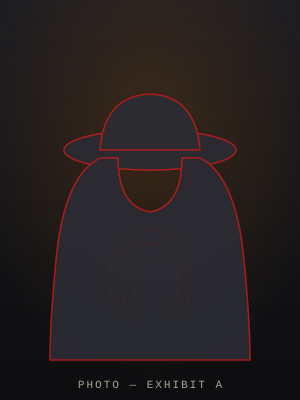

# Thirandi De Silva — Portfolio (Noir Detective Theme)

A single, self-contained portfolio site. No build tools, no frameworks — just open
`index.html` in any modern browser.

## Files
| File | What it is | Replace it? |
|------|------------|-------------|
| `index.html` | The entire site (HTML + CSS + JS in one file) | Edit to change content |
| `cv.pdf` | **Placeholder** CV wired to the "Download CV" button | ✅ Replace with your real CV (keep the name `cv.pdf`) |
| `profile.svg` | **Placeholder** dossier portrait | ✅ Swap for a real photo — see below |
| `README.md` | This file | — |

## Things to personalise
1. **Your CV** — overwrite `cv.pdf` with your own file (same filename).
2. **Your photo** — replace `profile.svg`, or point the image at your own file. In
   `index.html` find:
   ```html
   
   ```
   Change `src` to e.g. `profile.jpg` and drop that file in this folder.
3. **Contact form (Formspree)** — the form won't deliver email until you add your own
   endpoint. In `index.html` find `YOUR_FORM_ID` and replace it:
   - Sign up free at <https://formspree.io>, create a form, copy the id after `/f/`.
   - Set `action="https://formspree.io/f/xxxxxxxx"`.
   Until then, submitting shows a friendly "demo mode" message (validation still works).
4. **Social links** — find the two `href="#"` placeholders in the Contact section
   (GitHub & LinkedIn) and the `href="#"` GitHub/Demo links on each case file, and add
   your real URLs.

## Theme
Dark "night" mode is the default. The **DAYLIGHT** button in the nav switches to an
aged-paper light theme; the choice is remembered via `localStorage`. All animations
respect `prefers-reduced-motion`.
